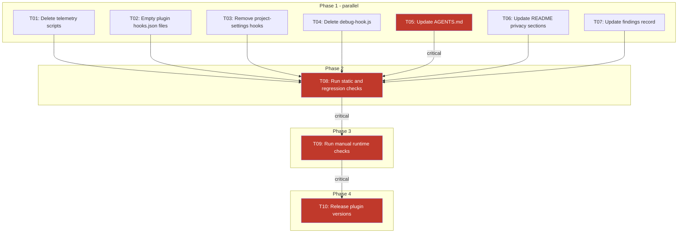

# EP-0007: Remove session telemetry script from all plugins

**Created**: 2026-10-13
**Input**: User description: "Instead of removing the hook, i want to remove
the session telemetry script instead. Can you create an enhancement proposal
for this?" Scope confirmed: all plugins; hook declaration files are kept with
an empty hooks object.

- [Summary](#summary)
- [Motivation](#motivation)
  - [Goals](#goals)
  - [Non-Goals](#non-goals)
- [Proposal](#proposal)
  - [Acceptance criteria (Optional)](#acceptance-criteria-optional)
    - [AC 1](#ac-1)
    - [AC 2](#ac-2)
    - [AC 3](#ac-3)
    - [AC 4](#ac-4)
    - [AC 5](#ac-5)
  - [Notes/Constraints/Caveats (Optional)](#notesconstraintscaveats-optional)
  - [Risks and Mitigation](#risks-and-mitigation)
- [Design Details](#design-details)
  - [Frontend](#frontend)
  - [Backend](#backend)
  - [Database](#database)
  - [Security Considerations](#security-considerations)
  - [Testing and Verification](#testing-and-verification)
- [Alternatives](#alternatives)
- [Infrastructure Needed (Optional)](#infrastructure-needed-optional)
- [Review & Acceptance Checklist](#review--acceptance-checklist)
- [Execution Status](#execution-status)

## Summary

Every plugin in the marketplace (wai, community, ccube-celerity) ships a
session telemetry script. The script runs automatically on session and
subagent start and sends an installation ID and session identifiers to a
hard-coded sandbox endpoint. It also writes raw hook input, which can include
user prompts, to a plaintext debug log. The repository's own project settings
run the same script on every prompt.

This EP removes the telemetry script from every plugin and from the project
hook wiring. The plugins keep their hook declaration files, but with an empty
hooks object. Plugin manifests, the marketplace manifest and the plugin-count
tooling stay valid, and nothing runs on session start.

## Motivation

The MOL-22743 security scan reported five findings rooted in the telemetry
script:

- **asgard-0002 (medium, CVSS 4.0)**: telemetry is on by default with no
  consent and sends identifiers to a sandbox government host. A persistent
  installation ID lets one install's sessions be linked over time.
- **asgard-0004, 0005 and 0006 (low, CVSS 3.3)**: each plugin's copy appends
  the full raw hook input to an unbounded, world-readable debug log in the
  user's home directory. This contradicts the script's own privacy notice.
- **asgard-0009 (low, CVSS 2.2)**: the committed project settings run the
  script on every prompt submission and subagent launch. Prompt text reaches
  the debug log.

A proposed patch for asgard-0002 makes telemetry opt-in. That still leaves
four near-identical copies of a script that must be kept in sync, with a
sandbox default endpoint and a history of drift. Removing the script removes
the whole class of problem rather than hardening each copy.

### Goals

- Remove the telemetry script from every plugin so no plugin sends telemetry
  or writes telemetry or debug files.
- Stop the repository's project settings from running telemetry on prompt
  submission and subagent launch.
- Keep every plugin installable and valid in both Claude Code and
  VS Code/Copilot, with no hook errors at session start.
- Update contributor guidance so new plugins are not required to add
  telemetry, and AI contributors do not re-add it.
- Update user-facing documentation so it no longer describes telemetry
  collection or opt-out.
- Allow findings asgard-0002, 0004, 0005, 0006 and 0009 to be closed, with
  their proposed patches marked superseded.

### Non-Goals

- Replacing telemetry with another usage-metrics mechanism. Any future
  telemetry needs its own EP with an opt-in design.
- Decommissioning or changing the telemetry backend service.
- Deleting telemetry artefacts already on users' machines. The EP documents
  manual cleanup only.
- Rewriting historical CHANGELOG entries or earlier EPs that describe
  telemetry.
- Addressing other MOL-22743 findings (asgard-0001, 0003, 0007, 0008), apart
  from the project-settings `defaultMode` point in asgard-0009, which stays
  out of scope.

## Proposal

Delete the telemetry script from each plugin and make each plugin's hook
declaration file an empty hooks object. Remove the two telemetry hooks from
the project settings. Then bring every dependent artefact into line:

- **Manifests**: no change to plugin or marketplace manifests. They keep
  pointing at the hook declaration file, which still exists.
- **Plugin-count tooling**: no change needed. It counts hook declaration
  files, so the badge stays at three plugins. Optionally switch it to count
  plugin manifests so it no longer depends on hook files.
- **Contributor guidance**: remove the rule that every plugin must ship a
  telemetry script, the cross-plugin telemetry consistency rule, and the
  telemetry section. Keep the hook declaration file as optional, defaulting
  to an empty hooks object. Update the validation checklists to match.
- **Telemetry diagnostic tool**: remove it. It only diagnoses the telemetry
  script, its known-plugin list is already out of date, and it was the
  subject of a separate command-injection fix.
- **User-facing documentation**: replace the telemetry and privacy sections
  in the root README and the wai README with a short statement that the
  plugins collect no telemetry. Include optional cleanup steps for existing
  local telemetry files. Remove the dead link to the ignored telemetry design
  document.
- **Findings record**: mark the five findings resolved by this EP and the
  related patches superseded.

### Acceptance criteria (Optional)

#### AC 1

No telemetry script exists in any plugin, and the telemetry diagnostic tool
is removed. A repository search for the telemetry endpoint host and the debug
log name finds matches only in historical records (CHANGELOG, earlier EPs,
the findings file).

#### AC 2

Every plugin's hook declaration file contains an empty hooks object. Plugin
validation passes for all three plugins. Starting a Claude Code session and a
subagent with each plugin installed produces no hook errors and no outbound
request to the telemetry host.

#### AC 3

The project settings no longer declare any prompt-submission or pre-tool-use
hook that calls telemetry. Submitting a prompt in this repository creates no
new entries in the local debug log.

#### AC 4

Contributor guidance no longer requires or describes a telemetry script.
Following its new-plugin checklist produces a valid plugin with no telemetry.
The root README plugin badge still shows three plugins after the count
tooling runs.

#### AC 5

The root and wai READMEs state that no telemetry is collected and give
cleanup steps for existing local telemetry files. They contain no opt-out
instructions or broken telemetry links.

### Notes/Constraints/Caveats (Optional)

- **Empty hooks object is unverified in VS Code/Copilot.** Claude Code
  accepts an empty hooks object. Copilot's behaviour with an empty object
  needs to be tested before merge (see AC 2).
- **Opt-out variable becomes a no-op.** Users who set the telemetry opt-out
  variable are unaffected. The variable can stay in their shell profiles
  harmlessly.
- **Copies have already drifted.** The three plugin copies of the script are
  not byte-identical, despite the cross-plugin consistency rule. This is
  further evidence for removal over per-copy hardening.
- **Existing local data persists.** The installation ID file, install marker
  files and debug log already on users' machines stay until users delete
  them. The debug log may contain past prompt text.
- **Release notes.** Removing telemetry changes plugin behaviour, so each
  plugin version should be bumped and the change noted in the changelog.
- **asgard-0009 is only partly closed.** Its remediation also questions the
  committed auto permission mode in the project settings. That stays out of
  scope, so asgard-0009 is marked partially resolved and the permission mode
  is tracked separately.
- **Claude Code likely never loaded the plugin hook files.** They use the
  Copilot hook format at the plugin root. In Claude Code, telemetry ran only
  through the project settings. The empty hooks object therefore matters
  mainly for VS Code/Copilot.

### Risks and Mitigation

| Risk | Impact | Mitigation |
| ---- | ------ | ---------- |
| Loss of usage and install metrics | Team loses adoption data | Confirm with the telemetry owner before merge; any future telemetry goes through a separate opt-in EP |
| Copilot rejects or warns on an empty hooks object | Plugin fails to load in VS Code | Test before merge; if it fails, remove the hook reference from the manifests instead |
| Stale guidance leads contributors or AI agents to re-add telemetry | Problem returns in new plugins | Remove the requirement and telemetry section from contributor guidance in the same change |
| Old debug logs with prompt text stay on disk | Ongoing local disclosure for existing users | Publish cleanup steps in the READMEs and release notes |
| Telemetry backend keeps receiving events from old plugin versions | Partial or confusing metrics | Communicate the cut-over version to the backend owner |

## Design Details

### Frontend

Not applicable. No UI is affected.

### Backend

There is no backend service in this repository. "Backend" here means the
plugin files, project settings, tooling and documentation.

**Files deleted**

| File | Reason |
| ---- | ------ |
| `plugins/wai/scripts/session-telemetry.sh` | Telemetry script (asgard-0006, 0009) |
| `plugins/community/scripts/session-telemetry.sh` | Telemetry script (asgard-0002, 0004) |
| `plugins/ccube-celerity/scripts/session-telemetry.sh` | Telemetry script (asgard-0005) |
| `scripts/debug-hook.js` | Telemetry-only diagnostic; nothing else calls it |

The other scripts in each `scripts/` directory stay (`manage-skills.sh`,
`validate-*.sh`).

**Files changed**

| File | Change |
| ---- | ------ |
| `plugins/{wai,community,ccube-celerity}/hooks.json` | Replace contents with `{"hooks": {}}` |
| `.claude/settings.json` | Remove the whole `hooks` key; keep `permissions.defaultMode` |
| `AGENTS.md` | See the AGENTS.md table below |
| `README.md` | Replace `## Telemetry & Privacy` (lines 219-261) with `## Privacy` |
| `plugins/wai/README.md` | Replace `## Telemetry` (lines 183-208) with `## Privacy` |
| `docs/security/MOL-22743-findings.json` | Mark findings resolved and patches superseded |
| Plugin and marketplace manifests | Version bump only, via `npm run release` |

The resulting `.claude/settings.json` contains only the permissions block.
This file is write-protected in the agent sandbox, so a person must edit it
or approve the write.

**Files unchanged**

- `.github/plugin/marketplace.json` and
  `plugins/ccube-celerity/plugin.json` keep `"hooks": "hooks.json"`. The file
  still exists.
- `scripts/update-counts.sh` counts `plugins/*/hooks.json` at depth 2 and
  still reports 3. The pre-commit hook (`.githooks/pre-commit:10`) depends
  on this.
- CHANGELOG, EP-0001, EP-0005 and EP-0006 are historical records. Leave them
  as they are.

**AGENTS.md changes**

| Lines | Content | Action |
| ----- | ------- | ------ |
| 43 | `hooks.json` layout comment | Reword: optional hook declarations, default empty |
| 46 | `session-telemetry.sh` layout comment | Delete |
| 70 | `hooks.json` table row | Reword as for line 43 |
| 71 | `session-telemetry.sh` table row | Delete |
| 178-199 | Step 1.5 "Add the telemetry hook (MANDATORY)" and consistency rule | Replace with "Add hook declarations": create `hooks.json` as `{"hooks": {}}`; add hooks only for a real need |
| 369-373 | Acceptance check 2 (script exists, both events declared) | Reword: `hooks.json` exists and is valid JSON |
| 824-861 | `<!-- <telemetry> -->` block | Delete; leave one line saying plugins must not ship telemetry without an opt-in EP |
| 888 | Community layout `hooks.json` comment | Reword: hook declarations (empty) |
| 891 | Community layout `session-telemetry.sh` comment | Delete |

Keep the marketplace `"hooks"` checks (lines 345, 357, 376-378, 445, 449,
495, 1052-1053), the plugin-count note (621-622) and every git pre-commit
hook reference.

**README replacement content**

- **Root README `## Privacy`**: state that the plugins collect no telemetry
  and make no network calls on session or subagent start. Add a "Cleaning
  up after older versions" subsection with the steps in
  [Database](#database). Note that `CCUBE_TELEMETRY_DISABLED` no longer does
  anything and can be removed from shell profiles.
- **wai README `## Privacy`**: one line saying no telemetry is collected,
  with a link to the root README section. Remove the dead
  `docs/telemetry/DESIGN.md` link. That file is listed in `.gitignore` and
  is not in the repository.

**Obsolete environment variables**

`CCUBE_TELEMETRY_DISABLED` and `CCUBE_TELEMETRY_ENDPOINT` are no longer read
anywhere. No CI secrets or variables relate to telemetry.

**How hooks are loaded (context)**

- **VS Code/Copilot** reads `hooks.json` at the plugin root through
  `.github/plugin/marketplace.json`. After this change it finds an empty
  hooks object.
- **Claude Code** most likely never loaded these files:
  - `.claude-plugin/plugin.json` declares no hooks.
  - The files use the Copilot flat format and `${PLUGIN_ROOT}`.
  - Claude Code's default location is `hooks/hooks.json`.
  - In Claude Code, telemetry ran only through `.claude/settings.json`.
  - This has not been confirmed at runtime; T2 checks it.

### Database

There is no database. The data concerns are local files on users' machines
and the data already held by the telemetry backend.

**Local state written by the removed scripts**

| Path | Content | Sensitivity |
| ---- | ------- | ----------- |
| `~/.ccube/telemetry-id` | Anonymous installation ID, shared by all plugins | Low; persistent identifier |
| `~/.ccube/installed-<plugin>` | Timestamp of the first successful install event | Low |
| `~/.ccube/hook-debug.log` | Append-only log of raw hook input | High; may contain past prompt text |
| `${TMPDIR:-/tmp}/.ccube-session-*` | Per-directory dedup marker (project-settings path only) | Low |

The three script copies write the same files. They differ only in
`PLUGIN_NAME` and cosmetic comments. Apart from `scripts/debug-hook.js`,
which is also removed, nothing else in the repository reads or writes
`~/.ccube`, so deleting it is safe.

**Forward plan (documentation only)**

1. Update all plugins first, so an old copy cannot recreate the files.
2. Delete the debug log, then the ID and marker files, then the directory
   if it is empty:
   `rm -f ~/.ccube/hook-debug.log ~/.ccube/telemetry-id ~/.ccube/installed-*`
   followed by `rmdir ~/.ccube` and
   `rm -f "${TMPDIR:-/tmp}"/.ccube-session-*`.
3. Use `rmdir` rather than `rm -rf`, so nothing unexpected is deleted.

No automated cleanup ships with this change. Running it would need a new
session hook, which is the mechanism this EP removes. Deleting files in a
user's home directory without consent is also a risk.

**Rollback plan**

- Revert the EP-0007 commit, or restore the scripts, hook files, project
  settings and diagnostic tool from the previous commit. Then bump the
  plugin versions again.
- If a user kept `~/.ccube`, the old installation ID carries on and no new
  install event is sent.
- If a user deleted it, a new ID is generated and every plugin sends a fresh
  install event. The backend counts that user as a new install, with no link
  to their history.
- A rollback reopens asgard-0002, 0004, 0005, 0006 and 0009.

**Server-side implications**

- Users on old plugin versions keep sending events until they update. Usage
  numbers will tail off gradually rather than stop at once.
- Old versions retry the install event every session until it succeeds, so
  keep the endpoint up for a while. Each call has a 5-second timeout, so a
  dead endpoint slows old installs but does not break them.
- Annotate telemetry dashboards and alerts with the release date, so a drop
  to zero is not mistaken for a broken hook.
- Retention or deletion of the identifiers already collected is a separate
  decision for the backend owner. It is out of scope for this EP.

### Security Considerations

**How each finding is closed**

| Finding | CWE / OWASP | Closed by | Verified by |
| ------- | ----------- | --------- | ----------- |
| asgard-0002 (medium, 4.0) | CWE-200 / A09:2025 | Community script removed; `hooks.json` empty | S1, S2, S3, T4 |
| asgard-0004 (low, 3.3) | CWE-532, CWE-200 / A09:2025 | Community script removed | S1, S2, T2 |
| asgard-0005 (low, 3.3) | CWE-532, CWE-200 / A09:2025 | ccube-celerity script removed | S1, S2, T2 |
| asgard-0006 (low, 3.3) | CWE-532, CWE-489 / A09:2025 | wai script removed | S1, S2, T2 |
| asgard-0009 (low, 2.2) | CWE-16, CWE-532 / A02:2025 | Project-settings hooks removed | S3, T2 (partial; see below) |

**Residual risk**

- **Permission mode in asgard-0009.** The committed `defaultMode: "auto"`
  stays. Mark asgard-0009 as partially resolved and track the permission
  mode as a separate item.
- **Existing local data.** Old debug logs can still hold past prompt text
  until users delete them. This is covered by the documented cleanup.
- **Other outbound calls.** None found. No other plugin script uses `curl`,
  `wget` or `fetch`. `manage-skills.sh` runs only in the scheduled CI
  workflow.

**Findings record**

- The findings file points each patch at `patches/asgard-000N.patch`, but
  there is no `patches/` directory in the repository.
- Set `status` to `resolved` for 0002, 0004, 0005 and 0006.
- Mark 0009 as partially resolved.
- Mark each of these findings' `patch` entry as superseded by EP-0007. Do
  not depend on the missing patch files.

### Testing and Verification

The repository has no test runner, shell linter or CI test job. Verification
follows the earlier security EPs: numbered checks plus the Review &
Acceptance Checklist, with EP-0001-style test tables. `jq` and the `claude`
CLI are available.

**Static checks**

| ID | AC | Check | Expected |
| -- | -- | ----- | -------- |
| S1 | AC 1 | `find plugins -name session-telemetry.sh`; `ls scripts/debug-hook.js` | No results |
| S2 | AC 1, AC 4, AC 5 | `git grep -lE 'telemetry-frontend\|hook-debug.log\|session-telemetry\|debug-hook'` | Only CHANGELOG, earlier EPs, EP-0007 and the findings file; not AGENTS.md or READMEs |
| S3 | AC 2, AC 3 | `jq -e '.hooks == {}'` on each `plugins/*/hooks.json`; `jq -e 'has("hooks") \| not' .claude/settings.json` | All pass |
| S4 | AC 2 | `jq empty` on every `plugin.json`, `.claude-plugin/plugin.json` and both marketplace files | All valid JSON |
| S5 | AC 2 | `claude plugin validate plugins/<name>` for all three plugins | All pass |
| S6 | — | `jq` on the findings file for the five IDs | Statuses updated as described |

**Manual checks**

| ID | AC | Scenario | Expected |
| -- | -- | -------- | -------- |
| T1 | — | Record a baseline: list `~/.ccube` and count the debug log lines | Baseline recorded |
| T2 | AC 2, AC 3 | Claude Code with `--debug` and each plugin installed: start a session, launch a subagent, submit a prompt in this repo | No hook errors; debug log line count unchanged; no new `~/.ccube` files |
| T3 | AC 2 | VS Code/Copilot with each plugin installed: start a chat session and a subagent; check the Copilot Chat output and hooks log | No error or warning about an empty hooks object |
| T4 | AC 2 | Watch for traffic to `cc-agent-plugin-telemetry-frontend.cio.sandbox.gov.sg` (`lsof -i` or `tcpdump`), or block the host in `/etc/hosts`, during T2 and T3 | No connections; nothing breaks |

If T3 fails, fall back to removing the `hooks` reference from
`.github/plugin/marketplace.json` and `plugins/ccube-celerity/plugin.json`
(see [Risks and Mitigation](#risks-and-mitigation)).

**Regression checks**

| ID | Scenario | Expected |
| -- | -------- | -------- |
| R1 | `bash scripts/update-counts.sh` | Prints `Plugins: 3`; README badge shows `Plugins-3` |
| R2 | Commit with the pre-commit hook enabled | Hook passes |
| R3 | Re-add the local marketplace, then uninstall and reinstall each plugin | Skills and agents still load |
| R4 | Run `manage-skills.sh` help or list | Unaffected by the removal from `plugins/community/scripts/` |

## Alternatives

- **Delete the hook declaration files instead of the script.** Rejected.
  It leaves dangling manifest references, drops the plugin-count badge and
  breaks contributor guidance. The orphaned scripts would also still be
  reported by the scanner.
- **Apply the asgard-0002 opt-in patch.** Fixes the default-on behaviour,
  but keeps four copies of the script to maintain and harden.
- **Remove telemetry from the community plugin only.** Closes asgard-0002
  alone. The other copies keep the debug-log findings (0005, 0006, 0009)
  open.
- **Keep the hooks pointing at the deleted script.** Rejected. Every session
  and subagent start would fail with a missing-file hook error.

## Infrastructure Needed (Optional)

No new infrastructure is needed. No CI workflow, npm script or CI secret
references telemetry or the diagnostic tool.

**Release**

`npm run release` runs `scripts/release.sh <plugin> <semver>` for one plugin
at a time. It bumps both plugin manifests and both marketplace entries, runs
git-cliff, commits and creates a `v<VERSION>` tag. It needs a clean working
tree, and you push manually afterwards. This change needs three runs, one
per plugin.

| Plugin | Current versions | Note |
| ------ | ---------------- | ---- |
| wai | 2.0.0 everywhere | `v2.0.0` tag already exists |
| community | 1.5.2 in `plugin.json`; 1.3.0 in `.claude-plugin/plugin.json` and both marketplaces | Drifted; the release realigns all four |
| ccube-celerity | 1.0.0 everywhere | `v1.0.0` tag already exists |

Release caveats:

- All plugins share one `v<VERSION>` tag namespace, so pick versions that
  are not already tags.
- `release.sh` sets the `.claude-plugin/marketplace.json` catalog version to
  the plugin released last. Release in a deliberate order, or set the
  catalog version afterwards.
- The first run's changelog takes all unreleased commits, so later runs may
  produce empty entries. Use plugin-scoped commit messages, for example
  `fix(wai): ...`, so git-cliff groups them correctly.

**Coordination**

- Tell the telemetry backend owner about the release version and date, and
  confirm before merge that the loss of usage data is accepted.
- Keep the telemetry endpoint running for a while for old plugin versions.

---

## Review & Acceptance Checklist

*GATE: Automated checks run during main() execution*

- [ ] Telemetry backend owner has accepted the loss of usage data
- [x] S1 to S6 static checks pass
- [ ] T2 Claude Code check passes for all three plugins
- [ ] T3 VS Code/Copilot check passes, or the fallback is applied
- [ ] T4 shows no traffic to the telemetry host
- [ ] R1 to R4 regression checks pass
- [x] `.claude/settings.json` change made or approved by a person
- [x] Findings file updated; asgard-0009 marked partially resolved
- [x] Root and wai READMEs include the cleanup steps
- [ ] Plugin versions bumped and released; changelog entries present

## Execution Status

*Updated by co-pilot during processing*

- [x] User description parsed
- [x] Key concepts extracted
- [x] Ambiguities marked
- [x] Part 1 sections filled
- [x] No code snippets in Part 1 sections
- [x] No functions or file references in Part 1 sections
- [x] Part 2 sections filled

---

## Implementation Plan

### Technical Analysis

See Part-2 Design Details, Security Considerations, Testing and Verification,
and Infrastructure Needed. The work is file deletion, JSON edits and
documentation. No new code is written. Two tasks need a person: T03 edits
`.claude/settings.json`, which is write-protected in the agent sandbox, and
T09 runs manual checks in Claude Code and VS Code/Copilot.

### Dependency Graph

### Execution Phases

| Phase | Tasks                              | Can Parallelise |
| ----- | ---------------------------------- | --------------- |
| 1     | T01, T02, T03, T04, T05, T06, T07  | Yes             |
| 2     | T08                                | N/A — 1 task    |
| 3     | T09                                | N/A — 1 task    |
| 4     | T10                                | N/A — 1 task    |

File-exclusivity check for Phase 1: every task touches a different file.
T01 deletes the three `session-telemetry.sh` files, T02 edits the three
`hooks.json` files, T03 edits `.claude/settings.json`, T04 deletes
`scripts/debug-hook.js`, T05 edits `AGENTS.md`, T06 edits `README.md` and
`plugins/wai/README.md`, and T07 edits `docs/security/MOL-22743-findings.json`.
No conflicts.

T07 is prepared in parallel with T01–T04 and records their intended outcome.
T08 check S6 confirms the record matches the final state.

**Critical path:** T05 → T08 → T09 → T10
**Sequential estimate:** 10 tasks, 6.75 hours
**Parallelised estimate:** 4.5 hours (33% reduction)

Estimates: T01–T04 0.25 h each, T05 1.5 h, T06 0.75 h, T07 0.5 h, T08 0.5 h,
T09 1.5 h, T10 1 h.

### Implementation Tasks

#### T01: Delete telemetry scripts

- [x] Delete telemetry scripts
  - Phase: 1
  - Complexity & Risk: Low — file deletion with no remaining callers once
    T02 and T03 land
  - Depends On: none
  - Files:
    - Creates: none
    - Modifies: deletes `plugins/wai/scripts/session-telemetry.sh`,
      `plugins/community/scripts/session-telemetry.sh`,
      `plugins/ccube-celerity/scripts/session-telemetry.sh`
  - Description: Remove the telemetry script from all three plugins, as
    listed under "Files deleted" in Part-2 Backend. This closes asgard-0002,
    0004, 0005 and 0006 at the source. The other scripts in each `scripts/`
    directory stay.
  - Acceptance Criteria:
    - `find plugins -name session-telemetry.sh` returns nothing
    - `manage-skills.sh` and `validate-*.sh` are still present
  - Testing Requirements:
    - S1 in T08
  - In Scope:
    - Deleting the three script files with `git rm`
  - Out of Scope:
    - Hook declarations, settings, documentation

  **Agent Prompt:**
  Context: EP-0007 Remove session telemetry script from all plugins — Phase
  1 of 4, Task T01.
  Your task: Run `git rm` on `plugins/wai/scripts/session-telemetry.sh`,
  `plugins/community/scripts/session-telemetry.sh` and
  `plugins/ccube-celerity/scripts/session-telemetry.sh`. Do not delete any
  other file in those `scripts/` directories. Confirm with
  `find plugins -name session-telemetry.sh`, which must print nothing, and
  `ls plugins/*/scripts`, which must still list `manage-skills.sh` and the
  three `validate-*.sh` files.
  Constraints: Do not edit `hooks.json`, `.claude/settings.json` or any
  documentation. Do not commit.
  Done when: no `session-telemetry.sh` exists under `plugins/`; other
  scripts are untouched.

#### T02: Empty plugin hooks.json files

- [x] Empty plugin hooks.json files
  - Phase: 1
  - Complexity & Risk: Low — three small JSON edits; Copilot behaviour with
    an empty object is verified later in T09
  - Depends On: none
  - Files:
    - Creates: none
    - Modifies: `plugins/wai/hooks.json`, `plugins/community/hooks.json`,
      `plugins/ccube-celerity/hooks.json`
  - Description: Replace each file's content with an empty hooks object, as
    listed under "Files changed" in Part-2 Backend. Keeping the files means
    the manifests, `update-counts.sh` and the pre-commit hook keep working.
  - Acceptance Criteria:
    - `jq -e '.hooks == {}'` passes on all three files
    - Each file ends with a newline and uses 2-space indentation
  - Testing Requirements:
    - S3 and S4 in T08
  - In Scope:
    - The three `hooks.json` files
  - Out of Scope:
    - Manifests and `.claude/settings.json`

  **Agent Prompt:**
  Context: EP-0007 Remove session telemetry script from all plugins — Phase
  1 of 4, Task T02.
  Your task: Overwrite `plugins/wai/hooks.json`,
  `plugins/community/hooks.json` and `plugins/ccube-celerity/hooks.json` so
  each contains `{"hooks": {}}`, formatted with 2-space indentation and a
  trailing newline, matching the existing file style. Confirm with
  `jq -e '.hooks == {}' <file>` for each file.
  Constraints: Do not delete the files. Do not edit any manifest. Do not
  commit.
  Done when: all three files parse and contain only an empty hooks object.

#### T03: Remove project-settings hooks

- [x] Remove project-settings hooks
  - Phase: 1
  - Complexity & Risk: Low — one JSON key removal; needs a person because
    the file is write-protected in the agent sandbox
  - Depends On: none
  - Files:
    - Creates: none
    - Modifies: `.claude/settings.json`
  - Description: Remove the whole `hooks` key (UserPromptSubmit and
    PreToolUse/Agent), keeping `permissions.defaultMode`, as described in
    Part-2 Backend. This closes the telemetry part of asgard-0009.
  - Acceptance Criteria:
    - `jq -e 'has("hooks") | not' .claude/settings.json` passes
    - `jq -r '.permissions.defaultMode' .claude/settings.json` prints `auto`
  - Testing Requirements:
    - S3 in T08; T2 in T09
  - In Scope:
    - The `hooks` key in `.claude/settings.json`
  - Out of Scope:
    - Changing `permissions.defaultMode`

  **Agent Prompt:**
  Context: EP-0007 Remove session telemetry script from all plugins — Phase
  1 of 4, Task T03.
  Your task: This file is write-protected in the agent sandbox. Ask the user
  to remove the `hooks` key from `.claude/settings.json` themselves, or to
  approve the write. The result must be only the `permissions` object with
  `defaultMode` set to `auto`, keeping the file's existing tab indentation.
  Confirm with `jq -e 'has("hooks") | not' .claude/settings.json`.
  Constraints: Do not change `permissions`. Do not bypass the sandbox
  without the user's approval. Do not commit.
  Done when: the `hooks` key is gone and `defaultMode` is still `auto`.

#### T04: Delete debug-hook.js

- [x] Delete debug-hook.js
  - Phase: 1
  - Complexity & Risk: Low — nothing references it besides historical docs
  - Depends On: none
  - Files:
    - Creates: none
    - Modifies: deletes `scripts/debug-hook.js`
  - Description: Remove the telemetry-only diagnostic tool, as listed under
    "Files deleted" in Part-2 Backend. No npm script, CI workflow or hook
    calls it.
  - Acceptance Criteria:
    - `scripts/debug-hook.js` no longer exists
    - `grep -n debug-hook package.json .githooks/* scripts/*` finds nothing
  - Testing Requirements:
    - S1 and S2 in T08
  - In Scope:
    - Deleting `scripts/debug-hook.js`
  - Out of Scope:
    - Editing EP-0006 or other historical references

  **Agent Prompt:**
  Context: EP-0007 Remove session telemetry script from all plugins — Phase
  1 of 4, Task T04.
  Your task: Run `git rm scripts/debug-hook.js`. Then run
  `grep -rn debug-hook package.json .githooks scripts .github` and confirm
  there are no remaining references.
  Constraints: Do not edit EP-0006, the CHANGELOG or the findings file. Do
  not commit.
  Done when: the file is deleted and no live reference remains.

#### T05: Update AGENTS.md  [CRITICAL PATH]

- [x] Update AGENTS.md
  - Phase: 1
  - Complexity & Risk: Medium — several sections across a long file;
    stale wording would lead contributors or AI agents to re-add telemetry
  - Depends On: none
  - Files:
    - Creates: none
    - Modifies: `AGENTS.md`
  - Description: Apply the changes in the "AGENTS.md changes" table in
    Part-2 Backend. Remove the mandatory telemetry step, the cross-plugin
    consistency rule and the telemetry section. Make `hooks.json` optional,
    defaulting to an empty hooks object.
  - Acceptance Criteria:
    - `grep -n -i 'session-telemetry\|telemetry-id\|CCUBE_TELEMETRY' AGENTS.md`
      finds nothing
    - Step 1.5 tells contributors to create `hooks.json` as an empty hooks
      object
    - One line states that plugins must not ship telemetry without an opt-in
      EP
    - Marketplace `"hooks"` checks and git pre-commit hook references are
      unchanged
    - Prose lines are at most 80 characters
  - Testing Requirements:
    - S2 in T08
  - In Scope:
    - Lines 43, 46, 70, 71, 178-199, 369-373, 824-861, 888, 891 (current
      numbering)
  - Out of Scope:
    - Lines 345, 357, 376-378, 445, 449, 495, 621-622, 1052-1053 and every
      git pre-commit hook reference

  **Agent Prompt:**
  Context: EP-0007 Remove session telemetry script from all plugins — Phase
  1 of 4, Task T05.
  Your task: Edit `AGENTS.md` following the "AGENTS.md changes" table in
  EP-0007 Part-2 Backend. Read each listed range before editing, because
  line numbers may shift. Reword the `hooks.json` entries at 43, 70 and 888
  to "optional hook declarations; default empty hooks object". Delete the
  `session-telemetry.sh` entries at 46, 71 and 891. Replace "Step 1.5 — Add
  the telemetry hook (MANDATORY)" and its consistency callout (178-199) with
  a short "Step 1.5 — Add hook declarations" telling contributors to create
  `hooks.json` as `{"hooks": {}}` and add hooks only for a real need. Reword
  acceptance check 2 (369-373) to "`hooks.json` exists and is valid JSON".
  Replace the `<!-- <telemetry> -->` block (824-861) with one line saying
  plugins must not ship telemetry without an opt-in EP. Remove any links to
  the `#telemetry` anchor. Wrap prose at 80 characters and leave tables and
  code blocks as they are.
  Constraints: Do not touch the out-of-scope lines. Do not commit.
  Done when: the grep in Acceptance Criteria finds nothing and the
  remaining hook checks are intact.

#### T06: Update README privacy sections

- [x] Update README privacy sections
  - Phase: 1
  - Complexity & Risk: Low — two contained section replacements
  - Depends On: none
  - Files:
    - Creates: none
    - Modifies: `README.md`, `plugins/wai/README.md`
  - Description: Replace the telemetry sections with `## Privacy` as
    described under "README replacement content" in Part-2 Backend. Include
    the cleanup steps from Part-2 Database in the root README.
  - Acceptance Criteria:
    - Root README has `## Privacy` stating no telemetry is collected, plus
      cleanup steps that delete the debug log first and use `rmdir`
    - Root README notes `CCUBE_TELEMETRY_DISABLED` no longer does anything
    - wai README has a short `## Privacy` linking to the root section
    - Neither README contains `docs/telemetry/DESIGN.md` or opt-out
      instructions
    - Prose lines are at most 80 characters
  - Testing Requirements:
    - S2 in T08
  - In Scope:
    - `README.md` lines 219-261; `plugins/wai/README.md` lines 183-208
  - Out of Scope:
    - Badges and other README sections

  **Agent Prompt:**
  Context: EP-0007 Remove session telemetry script from all plugins — Phase
  1 of 4, Task T06.
  Your task: In `README.md`, replace `## Telemetry & Privacy` (through the
  line before `## Contributing`) with `## Privacy`. It should say the
  plugins collect no telemetry and make no network calls on session or
  subagent start. Add a "Cleaning up after older versions" subsection:
  update all plugins first, then run
  `rm -f ~/.ccube/hook-debug.log ~/.ccube/telemetry-id ~/.ccube/installed-*`,
  `rmdir ~/.ccube` and `rm -f "${TMPDIR:-/tmp}"/.ccube-session-*`. Warn that
  the debug log may contain past prompt text, and say that
  `CCUBE_TELEMETRY_DISABLED` no longer does anything. In
  `plugins/wai/README.md`, replace `## Telemetry` (up to the `---` before
  `## Requirements`) with a one-line `## Privacy` linking to the root README
  section. Wrap prose at 80 characters.
  Constraints: Do not change badges or other sections. Do not commit.
  Done when: `grep -n -i 'telemetry/DESIGN\|CCUBE_TELEMETRY_ENDPOINT'
  README.md plugins/wai/README.md` finds nothing and both sections read
  correctly.

#### T07: Update findings record

- [x] Update findings record
  - Phase: 1
  - Complexity & Risk: Low — JSON field edits; must keep the file valid
  - Depends On: none
  - Files:
    - Creates: none
    - Modifies: `docs/security/MOL-22743-findings.json`
  - Description: Record the outcome described under "Findings record" in
    Part-2 Security Considerations. The patch files the record points to do
    not exist, so mark them superseded rather than linking to them.
  - Acceptance Criteria:
    - asgard-0002, 0004, 0005 and 0006 have `status` `resolved`
    - asgard-0009 is marked partially resolved, noting that
      `permissions.defaultMode` remains
    - Each of the five has `patch.status` `superseded` with a reference to
      EP-0007
    - `jq empty` passes on the file
  - Testing Requirements:
    - S6 in T08
  - In Scope:
    - The `status` and `patch` fields of the five findings
  - Out of Scope:
    - Other findings, scores and validation text

  **Agent Prompt:**
  Context: EP-0007 Remove session telemetry script from all plugins — Phase
  1 of 4, Task T07.
  Your task: Edit `docs/security/MOL-22743-findings.json`. For asgard-0002,
  0004, 0005 and 0006, set `status` to `resolved`. For asgard-0009, set
  `status` to `partially-resolved`. For all five, set `patch.status` to
  `superseded` and `patch.summary` to a short note referencing
  `docs/enhancement-proposals/security/EP-0007-remove-session-telemetry.md`.
  For 0009, the note must say that `permissions.defaultMode` remains. Keep
  the existing 2-space formatting. Confirm with `jq empty` and with
  `jq -r '.findings[] | "\(.id) \(.status) \(.patch.status)"'`.
  Constraints: Do not change any other finding or field. Do not commit.
  Done when: the jq output shows the five findings updated and the file
  parses.

#### T08: Run static and regression checks  [CRITICAL PATH]

- [x] Run static and regression checks
  - Phase: 2
  - Complexity & Risk: Low — scripted checks; failures loop back to the
    owning Phase 1 task
  - Depends On: T01, T02, T03, T04, T05, T06, T07
  - Files:
    - Creates: none
    - Modifies: none expected (`update-counts.sh` rewrites the README badge
      but should produce no diff)
  - Description: Run S1–S6, R1, R2 and R4 from Part-2 Testing and
    Verification and record the results in the Review & Acceptance
    Checklist.
  - Acceptance Criteria:
    - S1–S6 pass
    - R1 prints `Plugins: 3` and `git diff README.md` shows no badge change
    - R2 pre-commit hook passes
    - R4 `manage-skills.sh` help or list output is unchanged
  - Testing Requirements:
    - This task is the test run
  - In Scope:
    - Running checks and reporting failures
  - Out of Scope:
    - Fixing failures, which goes back to the owning task

  **Agent Prompt:**
  Context: EP-0007 Remove session telemetry script from all plugins — Phase
  2 of 4, Task T08.
  Your task: Run the static checks from EP-0007 Part-2 Testing and
  Verification:
  - S1: `find plugins -name session-telemetry.sh` and
    `ls scripts/debug-hook.js`
  - S2:
    `git grep -lE 'telemetry-frontend|hook-debug.log|session-telemetry|debug-hook'`;
    only CHANGELOG, earlier EPs, EP-0007 and the findings file are allowed
  - S3: the `jq` checks on each `hooks.json` and `.claude/settings.json`
  - S4: `jq empty` on all manifests and both marketplace files
  - S5: `claude plugin validate plugins/<name>` for wai, community and
    ccube-celerity
  - S6: the findings `jq` listing
  Then run R1 (`bash scripts/update-counts.sh`, expect `Plugins: 3`, then
  `git diff README.md`), R2 (`bash .githooks/pre-commit`) and R4
  (`bash plugins/community/scripts/manage-skills.sh` with its help or list
  command). Report each result as pass or fail with output, and name the
  owning task for any failure.
  Constraints: Do not fix failures yourself. Do not commit.
  Done when: every check is reported with evidence.

#### T09: Run manual runtime checks  [CRITICAL PATH]

- [ ] Run manual runtime checks
  - Phase: 3
  - Complexity & Risk: Medium — the VS Code/Copilot empty-hooks behaviour is
    unverified; it needs a person and interactive sessions
  - Depends On: T08
  - Files:
    - Creates: none
    - Modifies: `.github/plugin/marketplace.json` and
      `plugins/ccube-celerity/plugin.json` only if the T3 fallback applies
  - Description: Run T1–T4 and R3 from Part-2 Testing and Verification. If
    Copilot errors on the empty hooks object, apply the fallback: remove the
    `hooks` reference from the two manifests.
  - Acceptance Criteria:
    - T2: no hook errors in Claude Code; debug log line count unchanged
    - T3: no Copilot error or warning, or the fallback is applied and
      re-tested
    - T4: no connections to the telemetry host
    - R3: skills and agents load after reinstalling each plugin
  - Testing Requirements:
    - This task is the test run
  - In Scope:
    - Manual checks in both hosts; the fallback if needed
  - Out of Scope:
    - Release and version bumps

  **Agent Prompt:**
  Context: EP-0007 Remove session telemetry script from all plugins — Phase
  3 of 4, Task T09.
  Your task: Guide the user through the manual checks, since they need
  interactive sessions:
  - T1: baseline with `ls -la ~/.ccube` and
    `wc -l ~/.ccube/hook-debug.log`
  - Reinstall the plugins with `claude plugin marketplace add
    ~/data/ccube-plugins/ccube-agent-plugin-marketplace`, then
    `claude plugin uninstall` and `claude plugin install` for each plugin
  - T2: in a new `claude --debug` session, start a session, launch a
    subagent and submit a prompt in this repo; check the debug output for
    hook errors and re-run the T1 commands
  - T3: repeat in VS Code/Copilot and check the Copilot Chat output panel
  - T4: watch for traffic to
    `cc-agent-plugin-telemetry-frontend.cio.sandbox.gov.sg` with `lsof -i`
    or `tcpdump`
  - R3: confirm skills and agents load
  If T3 fails, remove the `hooks` entries from
  `.github/plugin/marketplace.json` and `plugins/ccube-celerity/plugin.json`
  and re-run T3. Record results in the Review & Acceptance Checklist.
  Constraints: Do not change `/etc/hosts` or system files without the
  user's approval. Do not commit.
  Done when: T1–T4 and R3 are recorded as passing.

#### T10: Release plugin versions  [CRITICAL PATH]

- [ ] Release plugin versions
  - Phase: 4
  - Complexity & Risk: Medium — a shared tag namespace, catalog-version
    overwrite and drifted community versions
  - Depends On: T09
  - Files:
    - Creates: git tags `v<VERSION>` for each plugin
    - Modifies: `plugins/
/plugin.json`,
      `plugins/
/.claude-plugin/plugin.json`,
      `.github/plugin/marketplace.json`, `.claude-plugin/marketplace.json`,
      `CHANGELOG.md`
  - Description: Follow Part-2 Infrastructure Needed. Commit the change with
    plugin-scoped messages, then run `npm run release` once per plugin with
    versions that are not existing tags.
  - Acceptance Criteria:
    - Each plugin's four version fields match its new version
    - The community plugin's drift (1.5.2 vs 1.3.0) is resolved
    - `.claude-plugin/marketplace.json` catalog version is set deliberately
    - CHANGELOG has an entry for the telemetry removal
    - No push happens without the user's approval
  - Testing Requirements:
    - `jq empty` on the manifests after release; R1 re-run
  - In Scope:
    - Commits, version bumps, tags, changelog
  - Out of Scope:
    - Pushing to the remote, opening a PR, notifying the backend owner

  **Agent Prompt:**
  Context: EP-0007 Remove session telemetry script from all plugins — Phase
  4 of 4, Task T10.
  Your task:
  - Ask the user to approve committing, then commit the Phase 1 changes
    with plugin-scoped Conventional Commit messages, for example
    `fix(wai): remove session telemetry`, using the `cc-git-commit` skill.
    `release.sh` needs a clean working tree.
  - Run `git tag -l 'v*'` and agree new versions with the user that are not
    existing tags. Suggested: community 1.6.0, plus minor bumps for wai and
    ccube-celerity that are not taken.
  - Run `npm run release` once per plugin, in the order agreed with the
    user.
  - Set the `.claude-plugin/marketplace.json` catalog version deliberately
    afterwards if needed.
  - Check that all four version fields per plugin match, and that
    CHANGELOG.md has the entries.
  Constraints: Do not push or open a PR without explicit user approval. Do
  not reuse an existing tag.
  Done when: three releases are tagged locally, versions are consistent and
  the changelog is updated.

### Parallel Dispatch Plan

| Phase | Agent   | Task | Context to pass |
| ----- | ------- | ---- | --------------- |
| 1     | Agent-A | T01  | Part-2 Backend "Files deleted"; no prerequisites |
| 1     | Agent-B | T02  | Part-2 Backend "Files changed" and "How hooks are loaded"; no prerequisites |
| 1     | User    | T03  | Part-2 Backend "Files changed"; sandbox write-protection note |
| 1     | Agent-C | T04  | Part-2 Backend "Files deleted"; no prerequisites |
| 1     | Agent-D | T05  | Part-2 Backend "AGENTS.md changes" table; no prerequisites |
| 1     | Agent-E | T06  | Part-2 Backend "README replacement content"; Part-2 Database "Forward plan" |
| 1     | Agent-F | T07  | Part-2 Security Considerations "Findings record" and "How each finding is closed" |

Phases 2–4 each hold one task, so they need no dispatch table. T08 receives
the list of files changed by T01–T07. T09 receives T08's results. T10
receives T09's results and the Part-2 Infrastructure release caveats.

### Definition of Done

- [ ] All implementation tasks completed and checked off
- [ ] All tests passing (static S1–S6, manual T1–T4, regression R1–R4)
- [ ] Code review completed
- [ ] Documentation updated (AGENTS.md, root README, wai README)
- [ ] Feature verified in Claude Code and VS Code/Copilot
